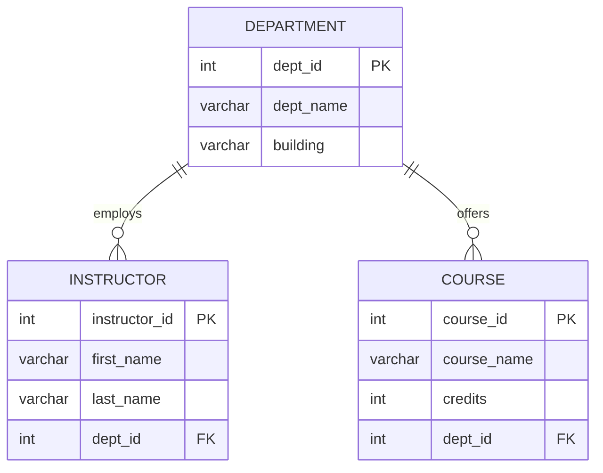

# HW5-1  Question 3: 2NF Relational Schema Design

Source: hw5-1 material doc (department / instructor / course)

## Cardinalities

- **DEPARTMENT to INSTRUCTOR**: one department has zero-or-many instructors; each instructor belongs to exactly one department (1 : 0..N)
- **DEPARTMENT to COURSE**: one department offers zero-or-many courses; each course belongs to exactly one department (1 : 0..N)

## Primary Keys

- `department.dept_id`
- `instructor.instructor_id`
- `course.course_id`

## 2NF Check

All non-key attributes depend on the whole primary key (each table has a single-column PK, no partial dependency possible). `dept_id` in `instructor`/`course` is a foreign key, not part of a composite key  no transitive or partial dependency violations.
